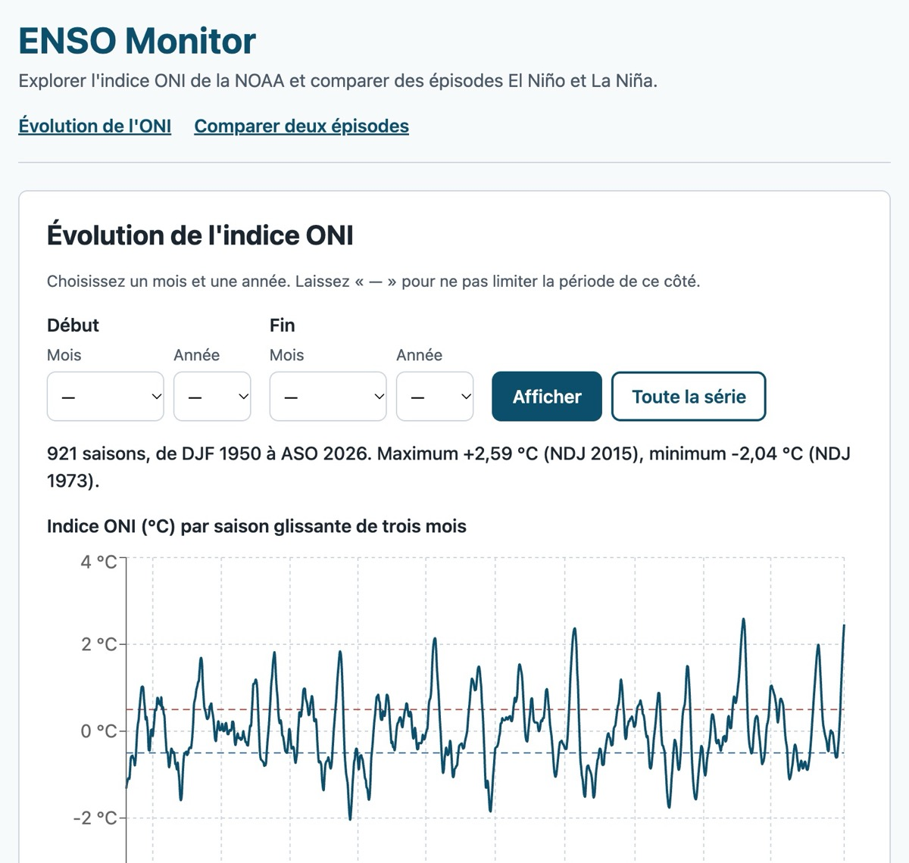
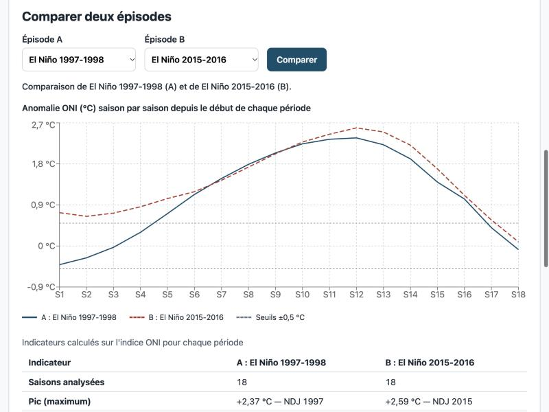

# ENSO Monitor

Plateforme d'analyse des épisodes **El Niño** et **La Niña** à partir de l'indice océanique **ONI** publié par la NOAA (Climate Prediction Center).

Projet individuel de certification — RNCP 36146, *Concepteur développeur de solutions digitales* (niveau 6), HETIC. Auteur : Raphael Paes Rodrigues da Silva.



## Sommaire

1. [Fonctionnalités](#fonctionnalités)
2. [Architecture et stack](#architecture-et-stack)
3. [Démarrage local](#démarrage-local)
4. [Variables d'environnement](#variables-denvironnement)
5. [Données](#données)
6. [API](#api)
7. [Tests](#tests)
8. [Qualité et sécurité](#qualité-et-sécurité)
9. [Déploiement](#déploiement)
10. [Limites connues](#limites-connues)
11. [Organisation du projet](#organisation-du-projet)
12. [Outils et utilisation de l'IA](#outils-et-utilisation-de-lia)
13. [Sources](#sources)

## Fonctionnalités

Les quatre fonctionnalités obligatoires du MVP :

| # | Fonctionnalité | Réalisation |
| - | -------------- | ----------- |
| 1 | Importer une série NOAA dans PostgreSQL avec Python, identifier la source, contrôler les doublons | ETL `python -m enso.etl` : 921 observations ONI, chaque import tracé (URL, date, empreinte SHA-256, compteurs), ré-import sans doublon, valeurs révisées mises à jour |
| 2 | Exposer les observations par une API FastAPI documentée, avec filtrage temporel et validation | `GET /api/v1/observations?debut&fin`, validation Pydantic, documentation OpenAPI sur `/api/docs` |
| 3 | Visualiser les valeurs dans React / TypeScript avec une courbe interactive et un filtre de période | courbe Recharts, filtre par mois, unités, version et source visibles, tableau de données accessible |
| 4 | Comparer deux épisodes historiques avec une interprétation prudente | El Niño 1997-1998 / 2015-2016 (et autres) : pic, durées, règle NOAA, interprétation, règles et limites affichées |



## Architecture et stack

```
Navigateur ──▶ React + TypeScript (Vite) ──/api/v1──▶ FastAPI ──▶ PostgreSQL ◀── ETL Python ◀── NOAA CPC
                                                        (SQLAlchemy, Alembic)     (Pandas, NumPy)
```

| Couche   | Technologies                                         | Version |
| -------- | ---------------------------------------------------- | ------- |
| Frontend | React, TypeScript (strict), Vite, Recharts           | React 19, TypeScript 7, Vite 8 |
| API      | Python, FastAPI, Pydantic                            | Python 3.14 |
| Données  | PostgreSQL, SQLAlchemy, Alembic                      | PostgreSQL 17, SQLAlchemy 2 |
| ETL      | Python, Pandas, NumPy, httpx                         | Pandas 3 |
| Tests    | Pytest, Vitest, Testing Library, axe-core            | — |
| Production | Docker Compose, Caddy                              | — |

Le backend suit une architecture en couches : le **domaine** (règles climatiques en Python pur) ne dépend ni de FastAPI ni de la base.

```
projet-enso-monitor/
├── backend/
│   ├── enso/
│   │   ├── domaine/        # règles métier pures : saisons, seuils, analyse des épisodes
│   │   ├── application/    # cas d'utilisation : consulter une série, comparer deux périodes
│   │   ├── infrastructure/ # PostgreSQL : modèles SQLAlchemy et dépôts
│   │   ├── etl/            # extraction → transformation → chargement (worker indépendant)
│   │   ├── api/            # routes FastAPI /api/v1, schémas Pydantic, gestion des erreurs
│   │   └── config.py       # paramètres lus depuis l'environnement
│   ├── alembic/            # migrations du schéma
│   ├── tests/              # Pytest (+ extrait authentique NOAA dans tests/donnees/)
│   ├── Dockerfile
│   └── pyproject.toml
├── frontend/
│   └── src/
│       ├── composants/     # composants d'interface (+ styles CSS Modules)
│       ├── hooks/          # chargement des données (useDonneesApi…)
│       ├── services/api.ts # seul point d'accès à l'API (fetch)
│       ├── types/api.ts    # types des réponses de l'API
│       ├── utilitaires/    # fonctions pures (formats français, résumé, alignement)
│       └── tests/          # Vitest + Testing Library
├── deploy/                 # production : compose.yaml, Caddy, sauvegardes, procédure
├── .github/workflows/      # intégration continue
├── compose.yaml            # PostgreSQL pour le développement
└── .env.example            # modèle des variables de développement
```

Le dossier de conception (livrable B) détaille les diagrammes UML, le schéma relationnel et la justification de chaque choix.

## Démarrage local

### Prérequis

- Docker et Docker Compose
- Python 3.13 ou supérieur (3.14 recommandé)
- Node.js 20.19+ ou 22.12+ (exigence de Vite ; 24 utilisé en CI)

### 1. Configuration

```bash
cp .env.example .env
```

Remplacer `changer-ce-mot-de-passe` par un mot de passe local, **la même valeur** dans `POSTGRES_PASSWORD` et dans `URL_BASE_DE_DONNEES`.

### 2. Base de données

```bash
docker compose up -d db
```

### 3. Backend : dépendances et schéma

```bash
cd backend
python3 -m venv .venv
source .venv/bin/activate
pip install -e ".[dev]"
alembic upgrade head      # crée les tables
```

### 4. Import des données NOAA

```bash
python -m enso.etl        # télécharge, valide et enregistre la série ONI
```

L'import peut être relancé sans risque : il n'insère que les périodes absentes et met à jour les valeurs révisées par la NOAA.

### 5. API

```bash
uvicorn enso.api.main:app --reload
```

- Documentation interactive : http://localhost:8000/api/docs
- Santé : http://localhost:8000/api/v1/sante

### 6. Frontend (autre terminal)

```bash
cd frontend
npm install
npm run dev               # http://localhost:5173 — /api est relayé vers le port 8000
```

## Variables d'environnement

Développement : fichier `.env` à la racine (modèle `.env.example`, jamais versionné).

| Variable | Obligatoire | Lue par | Rôle | Valeur par défaut |
| -------- | ----------- | ------- | ---- | ----------------- |
| `POSTGRES_USER`, `POSTGRES_PASSWORD`, `POSTGRES_DB` | oui | Docker Compose | identifiants de la base de développement | — |
| `URL_BASE_DE_DONNEES` | oui | API, ETL, Alembic | connexion SQLAlchemy (`postgresql+psycopg://…`) | — |
| `URL_FICHIER_ONI` | non | ETL | fichier ONI à importer | fichier officiel NOAA CPC |
| `ORIGINES_CORS` | non | API | origines autorisées (JSON) | `["http://localhost:5173"]` |
| `VITE_URL_API` | non | frontend | URL de l'API si elle n'est pas sur la même origine | vide (même origine) |

Production : `deploy/.env` (modèle `deploy/.env.example`), voir [`deploy/README.md`](deploy/README.md).

## Données

| Élément | Valeur |
| ------- | ------ |
| Indice | ONI — *Oceanic Niño Index*, **version 6 (ERSST.v6)** |
| Producteur | NOAA Climate Prediction Center |
| Fichier importé | https://www.cpc.ncep.noaa.gov/data/indices/oni.ascii.txt |
| Documentation | https://www.cpc.ncep.noaa.gov/products/analysis_monitoring/enso/oni/v6/index.php |
| Couverture | DJF 1950 → ASO 2026 (921 saisons glissantes de trois mois) |
| Unité | °C — anomalie de température de surface de la mer, région Niño 3.4 (5°N-5°S, 120°-170°O) |
| Extraction de référence | 19/11/2026 (fichier publié le 03/11/2026) |

- La version a été **vérifiée à la source** : les valeurs du fichier correspondent à la table officielle ONI v6, et non à la v5.
- La NOAA prévient que les **deux derniers mois peuvent être révisés** : l'ETL met à jour une valeur qui change.
- Depuis 2026, la NOAA utilise le **RONI** (*Relative ONI*) pour la surveillance officielle de l'ENSO. Ce projet, consacré à l'**analyse historique**, utilise l'ONI, comme le sujet l'autorise.
- Un **extrait authentique** (1997-1998, 24 saisons) est versionné dans `backend/tests/donnees/` : les tests ne dépendent pas d'Internet.

## API

| Méthode | Route | Description | Paramètres |
| ------- | ----- | ----------- | ---------- |
| GET | `/api/v1/sante` | État de l'API et de la base | — |
| GET | `/api/v1/observations` | Observations ONI avec unité, version, source et date d'extraction | `debut`, `fin` (facultatifs, `AAAA-MM-JJ`) |
| GET | `/api/v1/episodes/references` | Épisodes proposés à la comparaison | — |
| GET | `/api/v1/episodes/comparaison` | Comparaison de deux périodes : analyses, règles, interprétation, limites | `debut_a`, `fin_a`, `debut_b`, `fin_b` (obligatoires) |

Exemples :

```
GET /api/v1/observations?debut=1997-01-01&fin=1998-12-01
GET /api/v1/episodes/comparaison?debut_a=1997-01-01&fin_a=1998-06-01&debut_b=2015-01-01&fin_b=2016-06-01
```

### Règles de la comparaison

| Règle | Valeur | Origine |
| ----- | ------ | ------- |
| Épisode El Niño | ONI ≥ +0,5 °C pendant au moins 5 saisons consécutives | définition opérationnelle NOAA CPC |
| Épisode La Niña | ONI ≤ −0,5 °C pendant au moins 5 saisons consécutives | définition opérationnelle NOAA CPC |
| Intensité du pic | faible ≥ 0,5 · modérée ≥ 1,0 · forte ≥ 1,5 · très forte ≥ 2,0 °C | convention d'usage, **non officielle** |

Le terme « Super El Niño » n'est pas utilisé : il n'a pas de définition scientifique. Chaque comparaison renvoie ses limites avec le résultat.

### Codes et format des erreurs

| Code | Cas |
| ---- | --- |
| 200 | Succès |
| 404 | Aucune donnée importée, période sans observation, route inconnue |
| 422 | Entrée invalide : date mal formée, début après la fin, paramètre inconnu ou manquant |
| 500 | Erreur inattendue : message générique, détail uniquement dans les journaux |
| 503 | `/api/v1/sante` : base de données indisponible |

```json
{ "erreur": { "code": 422, "message": "Paramètres de requête invalides.",
              "details": [{ "champ": "debut", "message": "Input should be a valid date…" }] } }
```

## Tests

```bash
cd backend && pytest -v       # 47 tests (PostgreSQL démarré pour les tests d'intégration)
cd frontend && npm test       # 30 tests
```

Les tests d'intégration du backend utilisent une base dédiée `enso_test`, créée automatiquement ; la base de développement n'est jamais modifiée.

### Les trois tests minimaux du sujet

| Test exigé | Fichier | Vérification | Résultat |
| ---------- | ------- | ------------ | -------- |
| **n°1 — Données** : transformation Python sur des observations NOAA | `backend/tests/test_transformation.py` | doublons supprimés et comptés, saison/année/anomalie invalides rejetées, extrait réel 1997-1998 | 11 réussis |
| **n°2 — API** : route filtrée par période, réponse attendue et entrée invalide | `backend/tests/test_api_observations.py` | 1998 → 12 observations attendues, 4 entrées invalides → 422, aucune donnée → 404 | 7 réussis |
| **n°3 — Frontend** : un changement de période actualise la courbe ou les valeurs | `frontend/src/tests/SectionSerie.test.tsx` | choix janvier → décembre 1998, appel API avec la bonne période, nouveau résumé affiché ; aucune saisie libre (anomalie #44) | 6 réussis |

### Autres tests

| Fichier | Vérifie |
| ------- | ------- |
| `backend/tests/test_chargement.py` | classement des mesures : nouvelles, révisées, inchangées |
| `backend/tests/test_pipeline_etl.py` | ETL complet : traçabilité, ré-import sans doublon, révision, échec tracé sans données partielles |
| `backend/tests/test_api_erreurs.py` | format d'erreur unique, aucune fuite d'information (500), CORS |
| `backend/tests/test_episodes.py` | seuils d'intensité, séquences consécutives, El Niño 1997 / La Niña 1998, interprétation |
| `backend/tests/test_api_episodes.py` | route de comparaison : réponse complète, 422, 404, épisodes de référence |
| `frontend/src/tests/api.test.ts` | construction des requêtes, lecture des erreurs, API injoignable |
| `frontend/src/tests/SectionComparaison.test.tsx` | comparaison initiale, nouveau choix, même épisode refusé, alignement des séries |
| `frontend/src/tests/accessibilite.test.tsx` | audit axe-core (0 violation), structure, nom accessible des graphiques |
| `frontend/src/tests/contrastes.test.ts` | non-régression de l'anomalie #36 : contraste de toutes les couleurs (WCAG) |

L'intégration continue exécute l'ensemble à chaque pull request (voir ci-dessous).

## Qualité et sécurité

**Qualité**

- Intégration continue (`.github/workflows/ci.yml`) : lint, formatage, `alembic upgrade head` + `alembic check` sur une vraie base PostgreSQL, tests backend et frontend, build de production.
- Lint et formatage : Ruff (Python), oxlint et Prettier (TypeScript), TypeScript en mode strict.

```bash
cd backend && ruff check . && ruff format --check .
cd frontend && npm run lint && npm run format:check && npm run build
```

**Sécurité**

- Requêtes SQL paramétrées par SQLAlchemy (aucune concaténation de saisie utilisateur).
- Entrées validées par Pydantic (types, ordre des dates, paramètres inconnus refusés).
- Secrets hors Git (`.env`), configuration validée au démarrage.
- Erreurs inattendues sans détail technique dans la réponse.
- CORS limité au frontend déclaré et à `GET`.
- Production : seul Caddy est exposé (HTTPS, HSTS, CSP, `nosniff`), base et API sur un réseau interne sans accès Internet, processus non-root.
- Pas de contrôle d'accès : l'application ne contient ni administration ni donnée personnelle, et ne propose aucune route d'écriture.

**Accessibilité** : navigation au clavier et lien d'évitement, focus visible (contraste vérifié), résumé textuel et tableau de données équivalents aux graphiques, courbes distinguées par la couleur et le trait, interface responsive (aucun défilement horizontal à 375 px).

## Déploiement

Le déploiement cible (VPS, Docker Compose, Caddy, HTTPS, sauvegardes, mises à jour, supervision) est décrit pas à pas dans [`deploy/README.md`](deploy/README.md) et a été exécuté intégralement en local :

```bash
cd deploy && cp .env.example .env   # DOMAINE=localhost et un mot de passe généré (openssl rand -hex 24)
docker compose up -d --build        # images, migrations, API, Caddy
docker compose run --rm etl         # import NOAA
curl -k https://localhost/api/v1/sante
```

## Limites connues

- **Indice** : l'ONI ne retire pas la tendance au réchauffement global ; le RONI, indice officiel de la NOAA depuis 2026, la corrige. Comparer des décennies éloignées demande de la prudence.
- **Comparaison** : les durées sont comptées à l'intérieur des périodes choisies (l'épisode 2015-2016 commence dès OND 2014). Les épisodes proposés sont des fenêtres fixes (janvier → juin de l'année suivante), sans détection automatique.
- **Portée** : l'ONI décrit la température de surface d'une région du Pacifique ; l'application ne mesure aucun impact et ne fait aucune prévision.
- **Interface** : textes générés en français uniquement ; le module graphique (Recharts) alourdit le JavaScript (> 500 Ko avant compression), un chargement différé serait une optimisation possible.
- **Production** : un seul serveur (point unique de défaillance) ; une restauration interrompt l'API quelques secondes.

## Organisation du projet

- **Backlog** : [issues GitHub](https://github.com/Pharosi/projet-enso-monitor/issues) avec critères d'acceptation, jalons quotidiens (J1 à J6) et tableau de suivi (GitHub Projects).
- **Branches** : `main` (versions livrées), `develop` (intégration), une branche courte par issue — `feature/`, `fix/`, `test/`, `docs/`, `chore/`, `ci/` — fusionnée par pull request (`Closes #n`).
- **Commits** : [Conventional Commits](https://www.conventionalcommits.org/fr/), type en anglais, description en français.
- **Versions** : `v0.1.0` (données et ETL), `v0.2.0` (API), `v0.3.0` (frontend), `v1.0.0` (livraison).
- **Anomalies** : exemple complet avec l'issue #36 (contraste du focus) : test qui reproduit le problème, correction, non-régression (PR #37).

**Conventions de code** : identifiants en français sans accents, l'anglais seulement lorsque le langage ou le framework l'impose (hooks React `use…`, mots-clés). Chaque langage garde sa casse : `snake_case` en Python (`lister_mesures`), `camelCase` en TypeScript (`recupererObservations`), `PascalCase` pour les classes et composants (`GraphiqueOni`).

## Outils et utilisation de l'IA

Conformément au sujet, l'IA générative a été utilisée comme **assistant de développement**.

| Outil | Usage |
| ----- | ----- |
| Claude (Anthropic), via Claude Code | proposition d'architecture, génération de code, de tests et de documentation, aide au débogage, explications |
| GitHub CLI (`gh`) | saisie du backlog par script (issues, labels, jalons), pull requests, tableau de suivi, versions |
| Ruff, oxlint, Prettier, Pytest, Vitest, axe-core | contrôle qualité et tests automatisés |

**Parties principalement assistées** : structure du backend, ETL, API, frontend, tests, configuration de déploiement et documentation.

**Ma démarche** :

- définition du périmètre du MVP, des priorités et du planning à partir du sujet, puis replanification après un retard de deux jours ;
- validation de chaque décision (indice ONI, épisodes comparés, architecture, conventions de nommage et de Git) ;
- relecture de chaque pull request avant fusion et exécution des tests ;
- vérification des données à la source NOAA ;
- étude de chaque partie du code pour pouvoir l'expliquer et la modifier.

**Corrections apportées aux propositions de l'IA** : une hypothèse erronée sur la version de l'indice (ERSST.v5) a été corrigée après comparaison avec les tables officielles (ONI v6) ; un test d'accessibilité qui ne pouvait pas échouer a été renforcé ; le code a été simplifié lorsque c'était nécessaire pour rester explicable (fonctions courtes, un seul modèle de chargement des données).

## Sources

- NOAA CPC — ONI v6 : https://www.cpc.ncep.noaa.gov/products/analysis_monitoring/enso/oni/v6/index.php
- NOAA CPC — RONI : https://www.cpc.ncep.noaa.gov/products/analysis_monitoring/enso/roni/
- France compétences — RNCP 36146 : https://www.francecompetences.fr/recherche/rncp/36146
- WCAG 2.2 : https://www.w3.org/TR/WCAG22/
- FastAPI : https://fastapi.tiangolo.com/ · SQLAlchemy : https://docs.sqlalchemy.org/ · Alembic : https://alembic.sqlalchemy.org/
- React : https://react.dev/ · Vite : https://vite.dev/ · Recharts : https://recharts.org/
- Caddy : https://caddyserver.com/docs/ · Docker Compose : https://docs.docker.com/compose/
